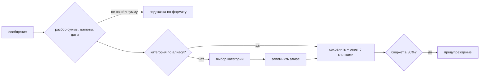

# Финансовый трекер: спецификация (бот + Mini App)

Версия: черновик 2, 2026-11-08

## 1. Цель и рамки

Личный трекер финансов для одного пользователя.
- **Бот** нужен для быстрого ввода одной строкой, уведомлений и коротких текстовых отчётов.
- **Mini App** нужен для графиков, редактирования, настройки бюджетов, категорий и регулярных платежей.

Что входит:
- мультивалюта с конвертацией в базовую;
- категории;
- месячные бюджеты;
- регулярные платежи;
- отчёты.

Чего нет:
- счетов;
- импорта выписок;
- нескольких пользователей;
- офлайн-режима.

## 2. Основные понятия

| Понятие | Описание |
|---|---|
| Базовая валюта | BYN (настраивается). В ней считаются бюджеты и отчёты |
| Операция | Расход или доход: сумма, валюта, категория, дата, заметка. Хранится сумма в исходной валюте, курс на дату и сумма в базовой |
| Категория | Название, emoji, тип (расход/доход), алиасы (слова, по которым бот её узнаёт). Добавляются, переименовываются и удаляются прямо в боте |
| Бюджет | Лимит на категорию на месяц в базовой валюте |
| Регулярный платёж | Сумма, валюта, категория, расписание. Добавляется автоматически, бот присылает уведомление |

Категории по умолчанию (крупные, дальше правятся вручную):
- **расходы:** 🍔 Еда, 🚕 Транспорт, 🏠 Жильё, 📱 Подписки и связь, 💊 Здоровье, 🛍 Покупки, 🎉 Развлечения, 🎁 Подарки, 📦 Прочее;
- **доходы:** 💰 Зарплата, ➕ Прочий доход.

Начальные алиасы, например для 🍔 Еды: кофе, кафе, обед, продукты, магазин, шаурма.

## 3. Бот

### 3.1 Быстрый ввод

Формат: `<описание> <сумма> [валюта] [дата]`. Порядок слов свободный, дробная часть пишется через точку или запятую.

| Ввод | Что делает бот |
|---|---|
| `кофе 5` | расход 5 BYN, 🍔 Еда, сегодня |
| `такси 20 usd` | расход 20 USD, курс на сегодня, 🚕 Транспорт |
| `продукты 45,5 вчера` | расход 45.50 BYN, 🍔 Еда, вчерашняя дата |
| `аптека 12 05.11` | расход 12 BYN, 💊 Здоровье, 05.11 |
| `+1500 зп` | доход 1500 BYN, 💰 Зарплата |
| `+300$ фриланс` | доход 300 USD, ➕ Прочий доход |

Валюта распознаётся по словам и символам:

| Валюта | Варианты ввода |
|---|---|
| USD | `usd`, `$`, `долл`, `дол` |
| EUR | `eur`, `€`, `евро` |
| RUB | `rub`, `₽`, `рос` |
| BYN | `byn`, `р`, `руб`, или валюта не указана |

Пример ответа на `такси 20 usd`:

```text
🚕 Транспорт  −20.00 USD (≈ 65.40 BYN, курс 3.27)
📅 сегодня
[🏷 Категория] [📅 Дата] [✏️ Сумма] [🗑 Удалить]
```

Если категорию определить не удалось:

```text
Не знаю категорию для «бассейн» — 15 BYN. Куда записать?
[💊 Здоровье] [🎉 Развлечения] [📦 Прочее] [ещё…] [＋ Новая категория]
```

После выбора бот запоминает «бассейн» как алиас этой категории и в следующий раз не спрашивает. Кнопка «＋ Новая категория» запускает создание категории (раздел «Управление категориями»), и операция сразу записывается в неё.

Ввод нескольких операций одним сообщением не поддерживается: одно сообщение — одна операция.



### 3.2 Предупреждения о бюджете

Если после записи расход по категории перешёл 80% или 100% лимита, бот добавляет к ответу строку:

```text
⚠️ 🍔 Еда: 504 / 600 BYN (84%), осталось 96 BYN на 22 дня
🚨 🍔 Еда: бюджет превышен — 642 / 600 BYN
```

Каждый порог срабатывает один раз в месяц.

### 3.3 Команды

| Команда | Что делает |
|---|---|
| `/start` | приветствие, краткая справка по формату ввода, кнопка Mini App |
| `/today` | операции и итог за сегодня |
| `/week` | итог за неделю по категориям |
| `/month [ноябрь]` | отчёт за месяц: доходы, расходы, топ категорий, бюджеты |
| `/last` | последние 10 операций с кнопками редактирования |
| `/undo` | удалить последнюю операцию |
| `/budget` | прогресс по всем бюджетам месяца |
| `/budget еда 600` | задать бюджет категории на текущий месяц |
| `/categories` | список категорий с алиасами и кнопками управления |
| `/cat add`, `/cat rename`, `/cat del` | добавить, переименовать, удалить категорию (подробнее ниже) |
| `/alias` | список алиасов; `/alias бассейн здоровье` привязывает слово к категории |
| `/budget copy` | скопировать бюджеты с прошлого месяца |
| `/recurring` | список регулярных платежей и ближайшие даты, кнопки удаления |
| `/recurring add Netflix 10 usd 15` | новый платёж: название, сумма, валюта, когда (`15` — каждый месяц, `пн` — каждую неделю, `01.03` — каждый год; `+` перед названием — доход) |
| `/cancel` | отменить ожидаемый ввод (название категории, новая сумма) |
| `/rate [usd]` | курсы валют к BYN на сегодня |
| `/app` | открыть Mini App (она же есть в кнопке меню) |

#### Управление категориями

Категориями можно управлять командами или кнопками из `/categories`.

| Ввод | Что делает бот |
|---|---|
| `/cat add Спорт 🏋️` | создаёт категорию расходов «🏋️ Спорт» |
| `/cat add +Кэшбэк 💸` | `+` перед названием создаёт категорию доходов |
| `/cat rename Спорт Фитнес` | переименовывает категорию, операции и бюджеты сохраняются |
| `/cat del Спорт` | удаляет категорию: сразу, если в ней нет операций, иначе спрашивает, что с ними делать |

Если у удаляемой категории есть операции:

```text
В «🏋️ Спорт» 12 операций на 340 BYN. Что с ними сделать?
[↪️ Перенести в другую категорию] [🗄 Скрыть категорию, операции оставить] [Отмена]
```

Скрытая категория не показывается при выборе и в боте, но её операции остаются в отчётах. Без emoji бот подставит 📁.

`/categories`:

```text
Расходы:
🍔 Еда — кофе, кафе, обед, продукты, магазин, шаурма
🚕 Транспорт — такси, метро, бензин
…
Доходы:
💰 Зарплата — зп, зарплата
[＋ Добавить] [✏️ Изменить] [🗑 Удалить]
```

Пример `/month`:

```text
📊 Ноябрь 2026
Доходы:  +2 400.00 BYN
Расходы: −1 735.20 BYN
Баланс:  +664.80 BYN

🍔 Еда        642.00  ⚠️ 107% бюджета
🏠 Жильё      450.00
🛍 Покупки    210.00  ███████░░░ 70%
🚕 Транспорт  160.50  ████░░░░░░ 40%
…
[📈 Открыть графики]
```

### 3.4 Регулярные платежи

В день платежа в 10:00 бот сам добавляет операцию и присылает уведомление:

```text
🔁 Добавил: Netflix — 10 USD (≈ 32.70 BYN), 📱 Подписки и связь
[✏️ Другая сумма] [↩️ Отменить]
```

- «✏️ Другая сумма» меняет сумму только этой операции, если в этот раз списали иначе.
- «↩️ Отменить» удаляет эту операцию, а расписание платежа остаётся прежним.

Пропущенные даты (например, если сервер лежал) добавляются при следующем запуске, по одному уведомлению на каждую.

### 3.5 Автоматические сообщения

- **1-го числа** приходит сводка за прошлый месяц (как `/month`) и вопрос «Скопировать бюджеты на новый месяц?» с кнопками [Да] [Открыть настройки].
- **Регулярные платежи** приходят по расписанию из раздела 3.4.

### 3.6 Доступ

Бот отвечает только на Telegram ID владельца, остальные сообщения игнорирует.

## 4. Mini App

Открывается кнопкой меню бота или командой `/app`. Использует тему Telegram (светлую или тёмную) и нативную кнопку «Назад». Внизу таббар из пяти вкладок.

### 4.1 Обзор (главная)

- Переключатель месяца: ‹ Ноябрь 2026 ›.
- Карточки: расходы, доходы, баланс месяца, разница расходов с прошлым месяцем в процентах.
- Круговая диаграмма расходов по категориям; тап по сегменту открывает операции этой категории.
- Столбики расходов по дням месяца.
- Блок «Бюджеты»: три категории, ближе всех к лимиту, с прогресс-барами.

### 4.2 Операции

- Список, сгруппированный по дням, с итогом за каждый день.
- Фильтры: период, категория, тип (расход или доход), валюта, поиск по заметке.
- Тап по операции открывает редактирование: сумма, валюта, категория, дата, заметка, удаление.
- Кнопка «＋» добавляет операцию через форму.

### 4.3 Бюджеты

- Список категорий с лимитом, потраченным и прогресс-баром (зелёный, жёлтый с 80%, красный после 100%).
- Прогноз: «при текущем темпе к концу месяца ≈ 260 BYN».
- Лимит задаётся или меняется прямо в списке.
- Кнопка «Скопировать с прошлого месяца».

### 4.4 Регулярные

- Список: название, сумма и валюта, категория, расписание, следующая дата.
- Создание и редактирование. Расписание бывает «каждый месяц N-го числа», «каждую неделю в день X» или «каждый год dd.mm».
- Пауза и удаление.

### 4.5 Отчёты

- Линейный график расходов и доходов по месяцам за последние 12 месяцев.
- Сравнение двух месяцев по категориям.
- Средние траты в месяц по категориям.
- Экспорт операций в CSV за период.

### 4.6 Настройки (через иконку в шапке)

- Базовая валюта.
- Категории: название, emoji, тип, алиасы, порядок, архивирование.
- Время уведомлений о регулярных платежах (по умолчанию 10:00).
- Пороги предупреждений бюджета (по умолчанию 80% и 100%).

## 5. Курсы валют

- API НБРБ не отвечает на запросы не из Беларуси, а сервер в Нидерландах, поэтому курсы берутся из других источников:
  - основной — [currency-api](https://github.com/fawazahmed0/exchange-api) через CDN jsdelivr (резерв — currency-api.pages.dev), есть курсы на прошлые даты;
  - запасной — open.er-api.com, только текущие курсы.
- Это рыночные курсы, от официальных НБРБ они отличаются на доли процента.
- Курсы на сегодня обновляются раз в 6 часов. Курс на прошлую дату загружается при первом запросе и сохраняется в БД.
- Если курса на дату нет, берётся ближайший сохранённый курс.
- Сумма в базовой валюте фиксируется на дату операции. Если дату операции изменить, сумма пересчитается по курсу новой даты.

## 6. Этапы

| Этап | Что входит |
|---|---|
| 1. MVP-бот | быстрый ввод, категории по умолчанию, алиасы, курсы НБРБ, `/today` `/month` `/last` `/undo` |
| 2. Бюджеты и регулярные | `/budget`, предупреждения, регулярные платежи, сводка 1-го числа |
| 3. Mini App | все экраны из раздела 4 |
| 4. Доработки | экспорт CSV, прогнозы, сравнение месяцев |

## 7. Принятые решения

- Базовая валюта — BYN.
- Категории по умолчанию крупные (🍔 Еда вместо Кафе и Продуктов); добавлять, переименовывать и удалять их можно прямо в боте.
- Регулярные платежи добавляются автоматически, бот присылает уведомление с кнопкой отмены.
- Одно сообщение — одна операция; ввода нескольких операций сразу нет.
